# efactura-admin

Panel web interno para la API de [java_efactura_uy](https://github.com/nicoribeiro/java_efactura_uy): comprobantes
emitidos y recibidos, sobres, emails recibidos, CAE, reporte diario, empresas, usuarios y procesos automáticos.

Stack: React 19 + TypeScript + Vite, [Refine](https://refine.dev) 5 y Ant Design 5.

## Puesta en marcha

```bash
npm ci
cp .env.example .env.local   # ajustar VITE_API_URL
npm run dev                  # http://localhost:5173
```

| Variable | Uso |
|---|---|
| `VITE_API_URL` | URL base de la API, incluyendo `/api/v1` (ej: `http://<servidor-api>:9000/api/v1`). Puede ser relativa (`/api/v1`) si el panel y la API se sirven desde el mismo origen |
| `VITE_API_TIMEOUT_MS` | Tiempo máximo de espera de la API (por defecto 30000) |

En desarrollo la API debe tener habilitado el filtro CORS (`app/Filters.java`).

Para trabajar contra otra API (ej. la de test) con otro puerto:

```bash
VITE_API_URL=http://<servidor-api-test>:9000/api/v1 npx vite --port 5174 --strictPort
```

Otros comandos: `npm run build` (chequea tipos y compila a `dist/`), `npm run lint`.

## Producción (Docker)

La imagen compila el panel y lo sirve con Nginx, que además reenvía `/api/` a la API. El panel y la API quedan en el
mismo origen, así que no hace falta CORS.

En el servidor (con Docker y el plugin compose), desde el repo clonado, crear un `.env` junto a `docker-compose.yml`
con la URL de la API (no se versiona) y levantar:

```bash
echo 'API_UPSTREAM=http://<servidor-api>:9000' > .env
docker compose up -d --build
```

El panel queda en `http://<servidor>:8080/`. Variables (en el entorno o en el `.env`):

| Variable | Por defecto | Uso |
|---|---|---|
| `API_UPSTREAM` | (obligatoria) | URL de la API, sin `/api/v1`. Sin ella compose no levanta y el contenedor no arranca |
| `PANEL_PORT` | `8080` | Puerto publicado en el servidor |

Actualizar a una versión nueva: `git pull && docker compose up -d --build`. Estado: `docker compose ps` (incluye el
healthcheck `/healthz`); logs de Nginx: `docker compose logs -f`.

Sin compose:

```bash
docker build -t efactura-admin .
docker run -d --name efactura-admin -p 8080:80 \
  -e API_UPSTREAM=http://<servidor-api>:9000 --restart unless-stopped efactura-admin
```

### Servidor con Podman

`docker compose` necesita el socket de Podman (una sola vez, con el usuario que levanta el panel):

```bash
systemctl --user enable --now podman.socket
echo 'export DOCKER_HOST=unix:///run/user/$UID/podman/podman.sock' >> ~/.bashrc && source ~/.bashrc
sudo loginctl enable-linger $USER              # que el socket y el contenedor sigan al cerrar sesión
systemctl --user enable podman-restart.service # que el contenedor vuelva a levantar al reiniciar
```

Después, `docker compose up -d --build` como arriba. Podman sin root no puede publicar puertos menores a 1024, por eso
el puerto por defecto es `8080`.

Archivos: `Dockerfile` (build en Node 22, runtime Nginx), `docker/nginx.conf.template` (rutas del panel, proxy de la API,
caché de `assets/`), `docker/05-api-upstream.sh` (no arranca sin `API_UPSTREAM`).

`VITE_API_URL` se fija al compilar; en la imagen es `/api/v1` (relativa). Para compilar contra otra URL:
`docker build --build-arg VITE_API_URL=http://... .`

## Pantallas

Las capturas son del entorno de prueba, con los datos reales reemplazados por datos ficticios.

Todas las tablas se pueden ordenar por columna: las paginadas en la API (`?orden=campo&sentido=asc|desc`), el resto en
el navegador (`src/utils/orden.ts`). Las acciones marcadas **ADMIN** solo las ven los administradores; **Usuarios** y
**Procesos** no aparecen en el menú para el resto.

### Encabezado

- **Empresa**: selector de la empresa con la que se trabaja; busca por RUT o razón social y avisa si la firma digital
  está vencida o por vencer. Todas las pantallas muestran los datos de la empresa elegida.
- **Buscar comprobante**: acepta `2311`, `A-2311` o `111 A-2311` y busca en emitidos y recibidos a la vez; con un
  resultado abre el detalle, con varios deja elegir.
- **RUT en DGI**: consulta cualquier RUT en DGI (denominación, nombre de fantasía, estado, domicilio fiscal, contactos y
  actividades). Solo consulta, no guarda nada.
- **Menú del usuario**: nombre, email y rol; *Mi cuenta y contraseña*; tema claro, oscuro o según el sistema; salir.
- **Pie**: versión del panel, commit y fecha de compilación, con enlace a este repositorio.

### Inicio

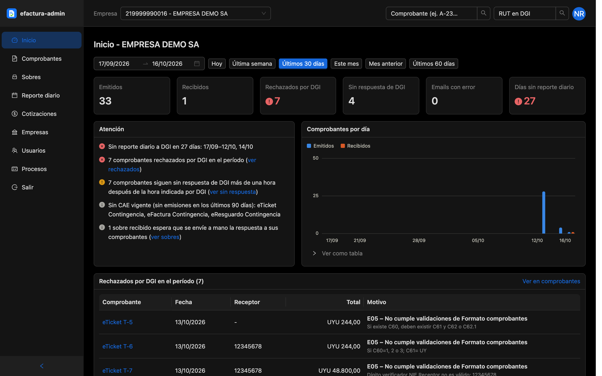

Tablero de la empresa para el período elegido (con rangos rápidos). Es solo lectura.

- **Tarjetas**: emitidos, recibidos, rechazados por DGI, sin respuesta de DGI, emails con error y días sin reporte
  diario. Cada una lleva al listado filtrado.
- **Atención**: avisos ordenados por gravedad, con enlaces a donde se resuelven. Cubre la firma digital (vencida, por
  vencer o sin cargar), días sin reporte diario, comprobantes rechazados o sin respuesta de DGI, CAE agotándose, vencidos
  o sin CAE vigente, emails recibidos con error, carpetas IMAP sin sincronizar, cotización del dólar o UI faltantes
  (sin ellas fallan los eTickets en moneda extranjera), respuestas a comprobantes recibidos atrasadas o pendientes y,
  para ADMIN, procesos automáticos que fallaron o no corren. Sin avisos muestra "Todo en orden".
- **Comprobantes por día**: gráfico de emitidos y recibidos, con opción de verlo como tabla.
- **Rechazados por DGI en el período**: comprobante, fecha, receptor, total y motivo del rechazo.
- **Emitidos por tipo** (cantidad, aceptados, rechazados, observados, sin respuesta, totales en UYU y USD) y
  **Recibidos por tipo**.
- **CAE por tipo de documento**: disponibles, emitidos en los últimos 90 días, hasta cuándo alcanzan a ese ritmo,
  vencimiento y estado.

### Comprobantes

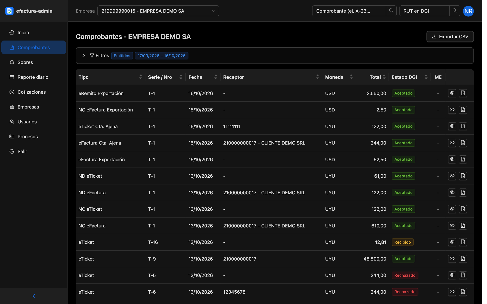

Comprobantes emitidos o recibidos de la empresa.

- **Filtros** (panel plegable que resume lo aplicado): emitidos/recibidos, estado DGI, período, RUT y razón social de la
  contraparte, tipo, serie y número.
- **Columnas**: tipo, serie y número, fecha, receptor o emisor, moneda, total, estado DGI y respuesta (ME) del receptor.
  Cada fila abre el detalle o el PDF.
- **Exportar CSV**: hasta 5000 filas, con progreso.

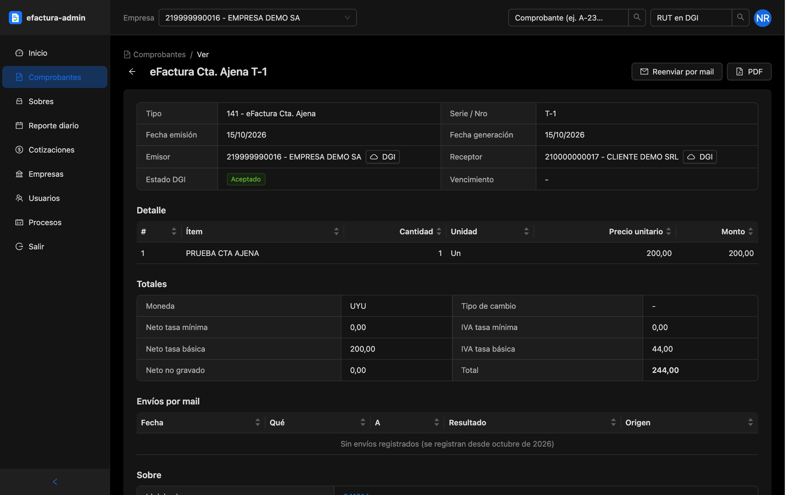

El **detalle** de un comprobante muestra:

- Alertas si DGI lo rechazó (con los motivos) o si no pasó los controles de recepción.
- Datos generales, emisor y receptor (con consulta a DGI), estado, vencimiento, adenda y los datos adicionales del XML.
- Referencias a otros comprobantes y, en los emitidos, los que lo referencian.
- Líneas del detalle y totales (neto e IVA por tasa, no gravado, total, moneda y tipo de cambio).
- Envíos por mail: fecha, qué se envió, a quién, resultado y origen.
- El sobre en el que viajó, con sus estados y los XML (sobre, respuesta de DGI, resultado de la consulta, sobre a la
  empresa y sus respuestas).

Acciones:

- **PDF** del comprobante.
- **Reenviar por mail** (emitidos): muestra a qué direcciones va antes de enviar.
- **Consultar a DGI** (ADMIN, emitidos sin respuesta): pide el resultado a DGI, con cuenta regresiva hasta la hora que
  indicó DGI.
- **Respuesta al emisor** (recibidos): muestra si la respuesta está pendiente y cuándo sale sola; permite enviarla ahora,
  rechazar el comprobante por un motivo comercial (E20 a E26) o deshacer el rechazo.

### Sobres

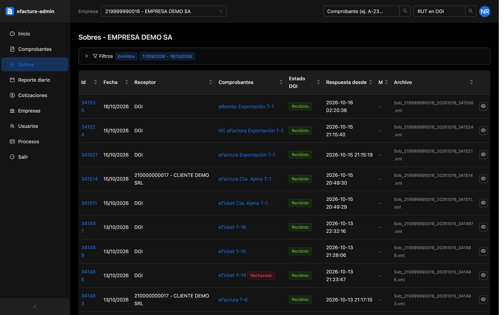

Sobres emitidos y recibidos. Es solo lectura.

- **Filtros**: emitidos/recibidos, período, estado DGI, respuesta del sobre (M), respuesta de los comprobantes (ME), RUT
  y razón social. Quedan en la URL.
- **Columnas**: id, fecha, receptor o emisor, comprobantes que contiene, estado DGI (con el motivo del rechazo),
  respuestas M y ME y archivo.
- **Detalle**: alertas de rechazo y de controles no superados, emisor y receptor, estados, comprobantes del sobre (con
  su estado y motivo) y los XML.

### Reporte diario

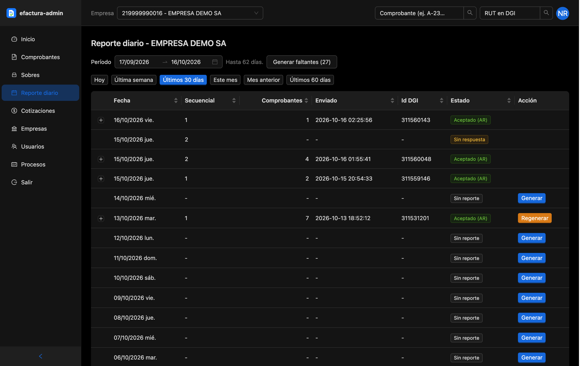

Reporte diario a DGI, por día (hasta 62 días por consulta).

- **Columnas**: fecha, secuencial, cantidad de comprobantes, fecha de envío, id de DGI y estado (aceptado, rechazado o
  sin reporte).
- **Detalle** (fila desplegable): carátula, respuesta de DGI, totales por tipo de comprobante (emitidos, utilizados,
  anulados, rangos y montos) y los XML enviado y recibido.
- **Generar faltantes** y **Generar / Regenerar** por día (ADMIN): generan el reporte y lo envían a DGI. Un día se
  puede generar recién 43 horas después de su comienzo; regenerar usa un secuencial nuevo que reemplaza al aceptado.

### Cotizaciones

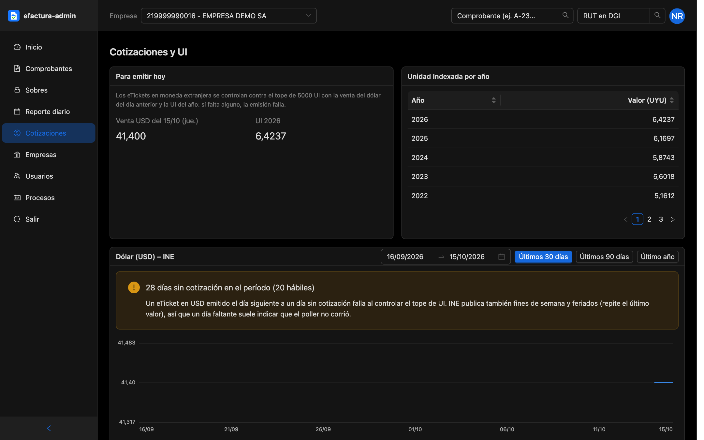

Valores que usa la emisión. Es solo lectura.

- **Para emitir hoy**: venta del dólar del día anterior y UI del año, los dos valores con los que se controla el tope de
  5000 UI de los eTickets en moneda extranjera.
- **Unidad Indexada por año**, con aviso si falta la del año en curso.
- **Dólar (USD) – INE**: gráfico y tabla (compra, venta, interbancario) de los últimos 30, 90 o 365 días, marcando los
  días sin cotización.

### Empresas

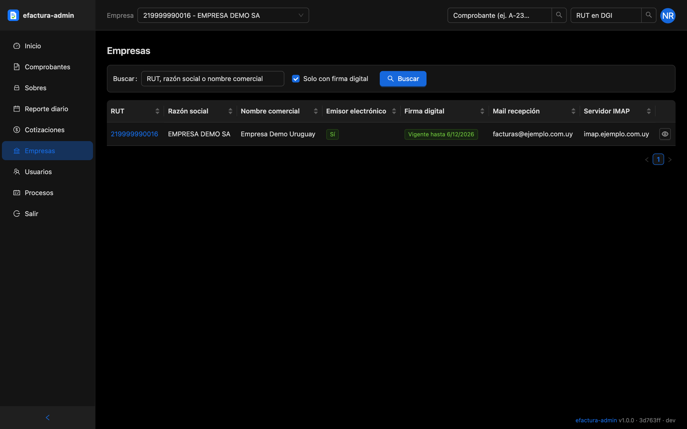

Listado con búsqueda y filtro *Solo con firma digital*: RUT, razón social, nombre comercial, si es emisor electrónico,
firma digital, mail de recepción y servidor IMAP. El detalle de cada empresa tiene estas pestañas:

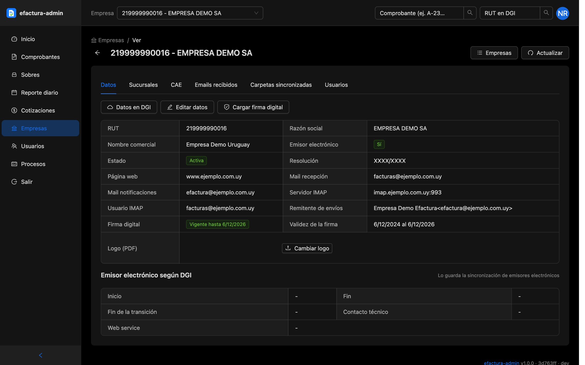

- **Datos**: datos generales, correo e IMAP, firma digital y su validez, logo de los PDF y los datos de emisor
  electrónico que publica DGI. Con **Datos en DGI** se consulta su RUT. ADMIN puede:
  - **Editar datos**: razón social, nombre comercial, web, resolución, correo, servidor y credenciales IMAP, remitente
    de los envíos, días para responder los comprobantes recibidos y si está activa o dada de baja.
  - **Cargar firma digital**: archivo `.p12`/`.pfx` con su contraseña, o certificado y clave en PEM; avisa si el
    certificado no corresponde al RUT.
  - **Cambiar logo**.
- **Sucursales**: código DGI, domicilio, ciudad, departamento, código postal y teléfono. ADMIN puede agregar, editar y
  borrar (no la única).
- **CAE**: pronóstico por tipo de documento y listado de todos los CAE (número, serie, rango, siguiente, uso,
  vencimiento y estado) con filtros. ADMIN puede **Cargar CAE**: los XML de DGI se validan en el navegador y se cargan
  solo los correctos.

  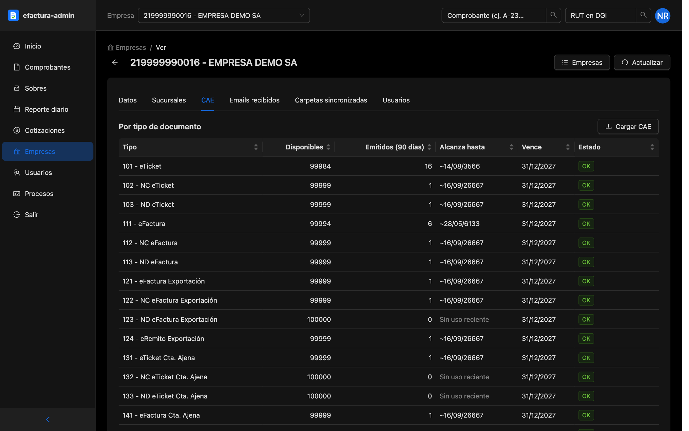

- **Emails recibidos**: los emails que llegan al buzón de la empresa, con sus adjuntos y el error si no se pudieron
  procesar. Se puede **Reintentar** uno o todos (opcionalmente, también los sobres que nunca se registraron) y, ADMIN,
  **Omitir** los que no corresponde procesar.
- **Carpetas sincronizadas**: carpetas IMAP que se leen, último UID, última sincronización y si están al día. Se
  actualiza sola cada minuto.
- **Usuarios**: quiénes tienen acceso a la empresa (asignados o administradores).

### Usuarios

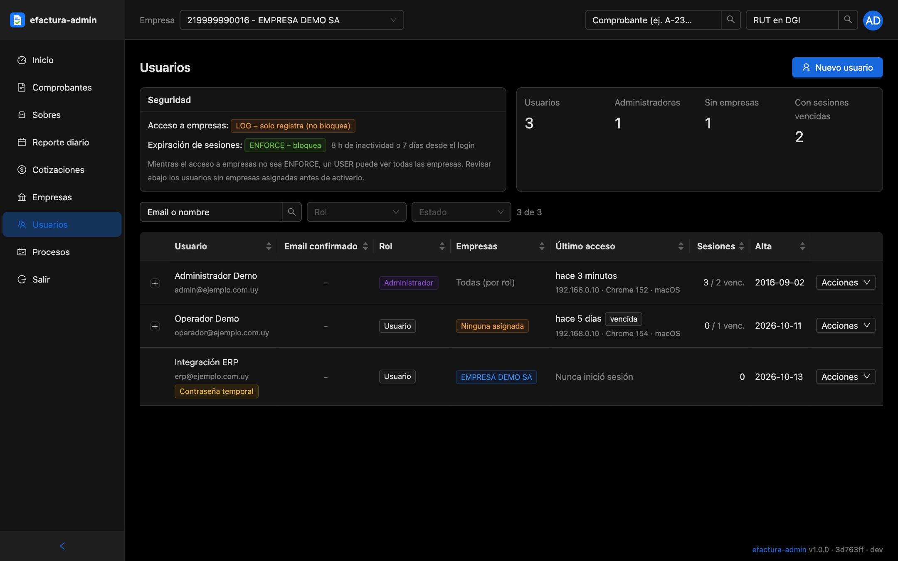

Solo para ADMIN.

- **Seguridad**: modo del control de acceso a empresas y de la expiración de sesiones, con sus límites.
- **Resumen**: usuarios, administradores, sin empresas asignadas y con sesiones vencidas.
- **Listado** (con filtros por nombre, rol y estado): email confirmado, rol, empresas, último acceso (IP y navegador),
  sesiones y alta. Cada fila se despliega con sus sesiones.
- **Nuevo usuario**: email, nombre, rol y empresas; la contraseña temporal se muestra una sola vez.
- **Acciones**: editar datos y rol, asignar o quitar empresas, generar una contraseña temporal, cerrar sus sesiones,
  ver o regenerar las credenciales HMAC (el secreto se muestra una sola vez) y activar o desactivar.

### Procesos

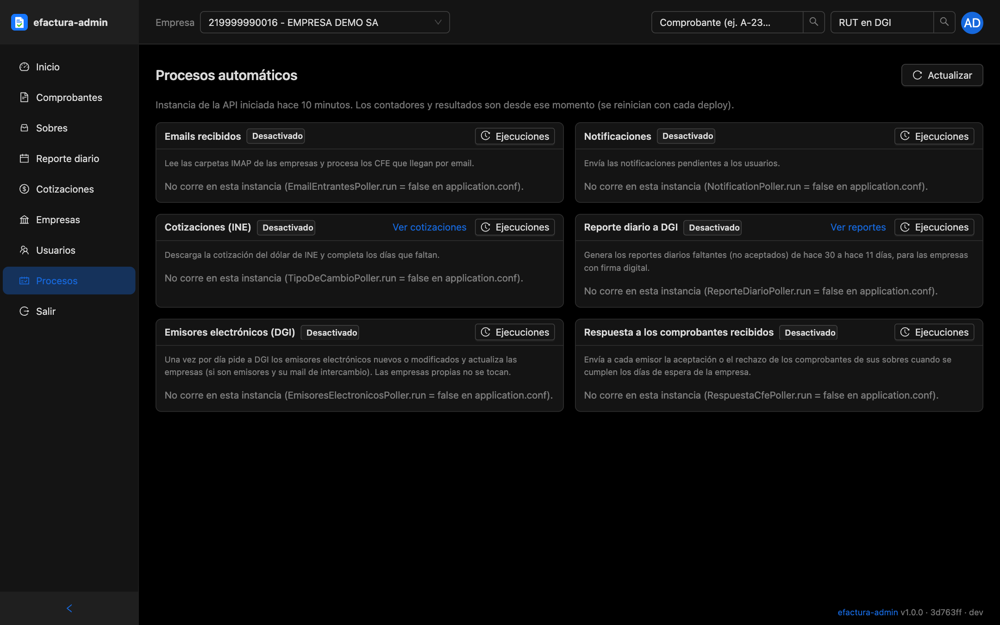

Solo para ADMIN, solo lectura. Estado de los procesos automáticos de la API: reporte diario, emails recibidos,
cotizaciones de INE, emisores electrónicos de DGI, respuesta a los comprobantes recibidos y notificaciones. De cada uno:
si está activo, si está corriendo o falló, cada cuánto corre, la última ejecución y su resultado o error, y el
historial de ejecuciones. Se actualiza solo cada 30 segundos; los contadores son desde el último arranque de la API.

### Cuenta

- **Login** y **¿Olvidaste tu contraseña?**: la contraseña se recupera con un código que llega por mail (solo si el
  email está confirmado).
- **Confirmar email**: código de 6 dígitos por mail; obligatorio para los usuarios nuevos.
- **Cambiar contraseña**: obligatorio al entrar con una contraseña temporal; también desde *Mi cuenta*.

## Estructura

- `src/api/http.ts`: cliente HTTP. Agrega el header `AUTH-TOKEN`, convierte los errores de la API (`result_message`,
  `result_detail`) y aplica la lista de escrituras permitidas (ver abajo).
- `src/providers/authProvider.ts`: login contra `POST /signin`; el token de sesión se guarda en `localStorage`. Maneja
  los pasos obligatorios (confirmar email, cambiar contraseña temporal) y vuelve al login cuando la sesión vence (401).
- `src/providers/dataProvider.ts`: recursos de Refine → rutas de la API. Paginados en la API: `empresas`, `documentos`
  (un documento se identifica por `tipo|serie|nro`), `sobres` y `emails`. Listas completas: `usuarios`, `sucursales`, `caes`.
- `src/contexts/empresa.tsx`: empresa seleccionada en el encabezado; las pantallas usan su RUT.
- `src/constants`: tipos de CFE (`cfe.ts`, el `name` es el del enum `TipoDoc` de la API), estados, firma.
- `src/pages`: una carpeta por sección (ver la tabla de pantallas).
- `src/utils`: orden de tablas, rangos rápidos de fechas, CSV, CAE.

## Escrituras permitidas

El panel es de solo lectura salvo una lista explícita (`ESCRITURAS_PERMITIDAS` en `src/api/http.ts`); cualquier otro
`POST`/`PUT`/`DELETE` se bloquea antes de llegar a la API. Lo permitido: login, recuperación de la contraseña,
confirmación del email y cambio de la contraseña propia; administración de usuarios; datos de la empresa y sus
sucursales; carga de CAE; reporte diario; reenvío por mail de un comprobante; reintento u omisión de los emails
recibidos; respuesta a los CFE recibidos y su rechazo comercial.

También se bloquean los `GET` de la API que tienen efectos (`GET_CON_EFECTOS`): consultan DGI y actualizan estados,
envían mails o regeneran credenciales. La consulta a DGI del resultado de un comprobante está permitida a propósito.

Para agregar una acción nueva hay que sumarla a esa lista; si no, el panel responde 405 sin llamar a la API. Las
restricciones por rol (ADMIN) las aplica la API; el panel solo oculta lo que no corresponde.

## Licencia

[MIT](LICENSE)
